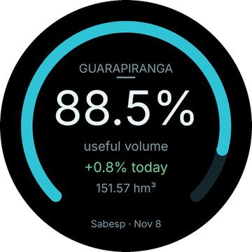
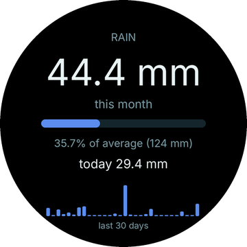
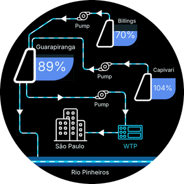
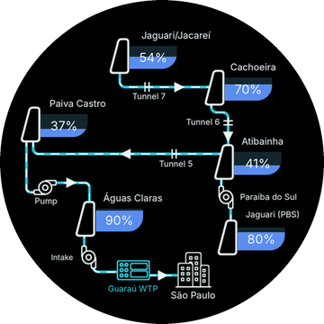
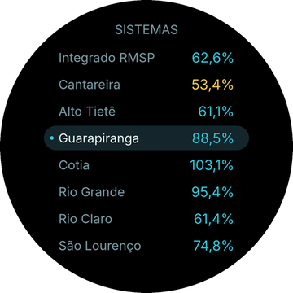
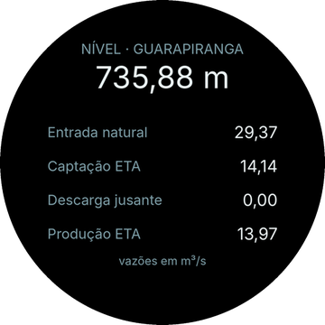
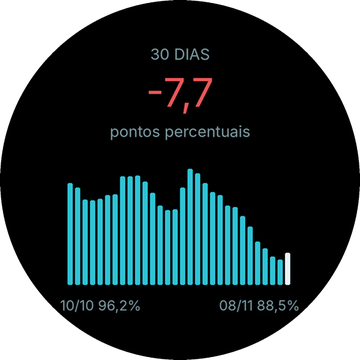

# Mananciais SP — mini app Zepp OS

**PT** · As represas da Grande São Paulo no pulso: volume útil, chuva, nível, vazões, diagrama "Por dentro do sistema" e tendência de 30 dias dos **8 sistemas da Sabesp**, com dados públicos do [Portal dos Mananciais](https://mananciais.sabesp.com.br), atualizados todo dia às 9h.

**EN** · Greater São Paulo's water reservoirs on your wrist: useful volume, rain, level, flows, an "inside the system" diagram and a 30-day trend for Sabesp's 8 systems, from public data. The interface follows the watch language (English or Portuguese).

App independente, sem vínculo com a Sabesp. Não coleta dados pessoais. · *Independent app, not affiliated with Sabesp. No personal data collected.*

<p>
  
  
  
  
</p>
<p>
  
  
  
  
</p>

## Relógios

Zepp OS com API 3.0+ e tela **redonda de 480 px** (os PNGs dos diagramas e do Sobre não escalam): Amazfit Balance, Balance 2, Balance 3, Balance Ultra, T-Rex 3, T-Rex 3 Pro (48 mm), T-Rex Ultra 2, Active Max e Cheetah Pro. Testado no Balance.

## Arquitetura

```
Relógio (page)  ──BLE──►  Zepp App (app-side)  ──HTTPS──►  mananciais.sabesp.com.br/api/v4
  cache por sistema       cache por sistema                  JSON público, sem chave
  /data/guara.json ──► mostradores podem ler (sempre Guarapiranga)
```

- O relógio não acessa a internet: quem chama a API é o **side service** dentro do Zepp App (`app-side/index.js`), via [ZML](https://github.com/zepp-health/zml).
- Ao abrir, o app mostra na hora o último dado salvo e depois busca o novo.
- A API da Sabesp às vezes cai em partes: só a data e o resumo geral são obrigatórios. O resto vem do cache do celular, e a tela marca "parcial" ou "Sabesp indisponível".
- `/data/guara.json` (só ASCII) pode ser lido por mostradores API 3 com `openSync({ path: 'guara.json', options: { appId: 1135461 } })`.

## Estrutura

| Caminho | Conteúdo |
|---|---|
| `page/index/index.page.js` | Telas, lista de sistemas, coroa, gestos |
| `page/index/diagrama.js` | "Por dentro do sistema": esquemas declarativos por sistema, PNG de fundo + reservatórios dinâmicos |
| `page/about/index.page.js` | Tela Sobre (deslize para a esquerda) e QR de apoio |
| `page/i18n.js` | Idioma pelo `getLanguage()` do relógio: português (pt-BR/pt-PT) ou inglês |
| `app-side/index.js`, `shared/sabesp.js` | Busca na API v4 da Sabesp e pacote compacto (~1 KB) para o relógio |
| `tools/` | Geração de SVG dos esquemas, máscara dos PNGs, QR, arte do Sobre em inglês, capturas da loja |
| `test/` | Simulação do Zepp OS com esbuild + dados reais da Sabesp |

## API Sabesp v4 (pública, sem chave)

| Endpoint | Uso |
|---|---|
| `GET /api/v4/dados/ultima-data` | Data do último dado consolidado |
| `GET /api/v4/sistemas/{id}/dados/diario/{ini}/{fim}` | Série diária do sistema |
| `GET /api/v4/sistemas/{id}/elementos/dados/resumo-diario/{data}` | Por represa (1 chuva, 2 nível, 684 volume útil %, 685 volume útil hm³) |
| `GET /api/v4/sistemas/dados/resumo-diario/{data}` | Todos os sistemas no dia |
| `GET /api/v4/represas` | Nomes das represas |

Sistemas: 75 Integrado RMSP · 64 Cantareira · 65 Alto Tietê · 66 Guarapiranga · 67 Cotia · 68 Rio Grande · 69 Rio Claro · 72 São Lourenço.

As faixas de cor do volume (≥60 · 40–60 · 30–40 · <30%) são decisão de design deste app, não classificação oficial da Sabesp.

## Compilar

Requer Node.js e a [Zeus CLI](https://docs.zepp.com/docs/guides/tools/cli/).

```bash
npm install
zeus preview      # instala no relógio pelo QR (Zepp App › modo desenvolvedor)
zeus build        # gera dist/*.zab para a loja
```

O `appId` 1135461 é registrado no Zepp Console do autor. Para publicar um fork, registre um app próprio e troque o `appId` no `app.json`.

## Testes

```bash
node test/harness.mjs                 # português
LANG_ZEPP=2 node test/harness.mjs     # inglês (2 = en-US)
node test/sobre.mjs
node test/side.mjs                    # side service, incluindo queda parcial da API
```

## Licença

- **Código** (`.js`, `.mjs`, `.py`): [MIT](LICENSE).
- **Arte** (ícone, diagramas, tela Sobre, QR em `assets/` e as imagens de `docs/`) e a marca **ArtBombs**: todos os direitos reservados, ver [ASSETS-LICENSE.md](ASSETS-LICENSE.md).
- Os dados são da Sabesp (Portal dos Mananciais), consultados em tempo real; este repositório não os redistribui, exceto amostras para testes.

Feito por **ArtBombs**.
